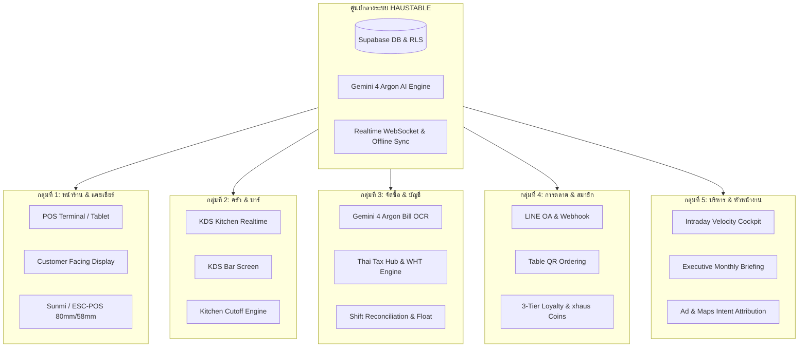
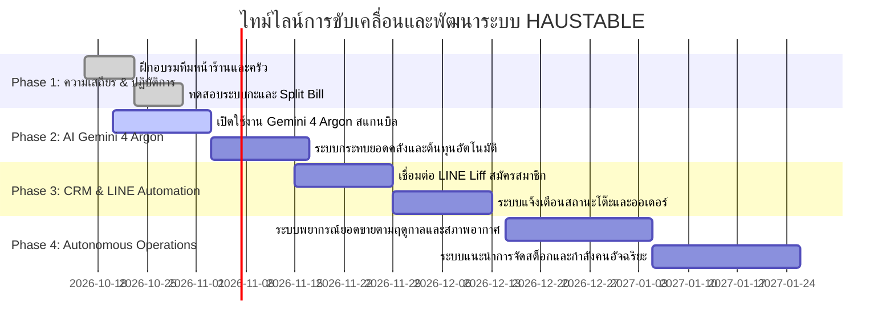

# แผนพัฒนาระบบและการดำเนินงานสำหรับกลุ่มทำงาน (System Development & Operations Roadmap)
**โครงการ: IN THE HAUS / HAUSTABLE — All-in-One POS, QR Ordering, KDS, CRM & Tax Engine**  
**เวอร์ชัน:** 2026.4 (อัปเดตแกน AI: **Gemini 4 Argon**)  
**สถานะ:** เอกสารทางการสำหรับทีมปฏิบัติการและพัฒนา (Official Team Operational Document)

---

## 🏛️ 1. วิสัยทัศน์และหลักการสำคัญของระบบ (System Tenets & Strategic Vision)

ระบบ **HAUSTABLE** ถูกสร้างขึ้นเพื่อเป็น **Single Source of Truth** ขับเคลื่อนร้านอาหารและบาร์ริมแม่น้ำโขงระดับ Fine Casual & Bistro โดยมุ่งเน้น 4 หลักการหลัก:
1. **Zero-Friction Hospitality:** การบริการต้องไร้รอยต่อ ลูกค้าสั่งง่าย พนักงานทำงานสะดวก ครัวรับออเดอร์แม่นยำ
2. **Offline-First Resilience:** ระบบหน้าร้าน (POS) ต้องทำงานได้ต่อเนื่อง 100% แม้อินเทอร์เน็ตหลุด มีแคชในเครื่องและการรับรองความถูกต้องด้วย PIN Code ออฟไลน์
3. **Financial & Tax Integrity:** ตัวเลขการเงิน ส่วนลด และภาษีสรรพากร (VAT 7%, WHT) ถูกต้องตามกฎหมาย 100% ป้องกันข้อผิดพลาดเงินสดและสต็อก
4. **Autonomous AI & Executive Intelligence:** ขับเคลื่อนด้วยขุมพลัง **Google Gemini 4 Argon** ในการอ่านบิล/ใบเสร็จเข้าคลังอัตโนมัติ (AI Vision OCR) และประเมินกลยุทธ์ยอดขายรายช่วงเวลา (Intraday Velocity Cockpit)

---

## 👥 2. โครงสร้างและหน้าที่รับผิดชอบของ 6 กลุ่มทำงาน (The 6 Functional Groups)

| กลุ่มทำงาน (Functional Group) | สมาชิกหลัก | ความรับผิดชอบหลักในระบบ | เครื่องมือหลักในระบบ |
| :--- | :--- | :--- | :--- |
| **1. ทีมบริการหน้าร้าน & แคชเชียร์** | กัปตัน, พนักงานเสิร์ฟ, แคชเชียร์ | • เปิด-ปิดกะเงินสด ตรวจนับเงินทอน (Cash Float) • จัดสรรที่นั่งและสถานะโต๊ะ (Live Seated) • บริหารการย้ายโต๊ะ / รวมบิล (Move & Merge) • ชำระเงิน Split Bill และออกใบกำกับภาษีอย่างย่อ | `/pos` จอ CFD ESC/POS Thermal Printer |
| **2. ทีมครัว & บาร์เครื่องดื่ม** | หัวหน้าครัว, เชฟ, บาร์เทนเดอร์ | • รับและปรุงอาหารตามลำดับบัตรคิวบนจอ KDS • จัดการสลิปที่แยกพิมพ์อัตโนมัติ (ครัว/บาร์) • กดเปลี่ยนสถานะจาน (กำลังทำ / พร้อมเสิร์ฟ) • ตรวจสอบเวลาตัดรอบครัว (Kitchen Cutoff) | `/kitchen` (KDS) Web Audio Alerts สลิปพิมพ์แยกแผนก |
| **3. ทีมจัดซื้อ บัญชี & คลังสินค้า** | ฝ่ายจัดซื้อ, นักบัญชี, ผู้ตรวจสอบ | • ถ่ายรูปสแกนบิลซื้อของด้วย **Gemini 4 Argon OCR** • บันทึกต้นทุนอาหารและค่าใช้จ่ายดำเนินงาน • ตรวจสอบภาษีซื้อ/ขาย (VAT 7%) และหัก ณ ที่จ่าย (WHT) • ตรวจสอบรายงานปิดกะเงินสด (Shift Audit) | `/admin` (Tax Hub) ExpenseModal (Gemini 4 Argon) Tax Document PDF Export |
| **4. ทีมการตลาด ลูกค้าสัมพันธ์ & LINE OA** | ฝ่ายการตลาด, แอดมิน LINE | • มอนิเตอร์สัญญาณ Ad Intent (ขอเส้นทาง Maps, โทร, ทักแชท) • บริหารสิทธิ์สมาชิก 3 ระดับ (`Common`, `People`, `Inner`) • จัดการแคมเปญกระตุ้นยอดช่วงบ่าย (Afternoon Downtime) • ดูแลระบบแลกแต้ม xhaus Coins และแสตมป์สะสม | LINE Official Account Webhook Engine CRM Settings Tab |
| **5. ทีมบริหาร & ยุทธศาสตร์ร้าน** | เจ้าของร้าน, ผู้จัดการทั่วไป | • ติดตามยอดขายแบบเรียลไทม์ผ่าน 4 ช่วงเวลา (Dayparts) • ตรวจสอบชั่วโมงคุ้มทุนประจำวัน (Break-Even Hour) • ใช้งาน Gemini 4 Argon สรุปวิเคราะห์ผลประกอบการประจำเดือน • ปรับเปลี่ยนแผนงานและเป้าหมายยอดขาย (Sales Target Pace) | IntradayVelocityDaypartCockpit MonthlyExecutiveReportModal SalesDriversTable |
| **6. ทีมพัฒนาระบบ & ไอที** | ผู้พัฒนาระบบ, ผู้ดูแลระบบ | • บำรุงรักษาโค้ดเบส React 19, Supabase RLS, Edge Functions • ตรวจสอบความถูกต้องของโมเดล AI (`gemini-4-argon`) • รองรับระบบพิมพ์ภาษาไทย TIS-620 บนอุปกรณ์ Sunmi/ฮาร์ดแวร์ • ตรวจสอบชุดทดสอบอัตโนมัติ (Automated Tests 425 ข้อ) | Supabase Dashboard Vitest Suite GitHub Repository |

---

## 📅 3. แผนงานพัฒนาและขับเคลื่อน 4 เฟส (4-Phase Strategic Roadmap)

### เฟสที่ 1: ความเสถียรและวินัยการปฏิบัติการหน้าร้าน (Immediate Rollout & Day-to-Day Stability)
*เป้าหมาย: หน้าร้านและครัวทำงานราบรื่น ตัวเลขปิดกะเงินสดแม่นยำ 100%*
- **งานหลัก:**
  1. ซักซ้อมการเปิดกะด้วยการบันทึกเงินทอนเริ่มต้น (`Opening Float`) ห้ามเริ่มขายโดยไม่เปิดกะ
  2. กำชับการใช้ฟังก์ชัน **Move Table (ย้ายโต๊ะ)** และ **Merge Bills (รวมโต๊ะ)** แทนการสร้างบิลใหม่ เพื่อรักษาสิทธิ์สมาชิก CRM และประวัติออเดอร์
  3. ฝึกพนักงานให้คุ้นเคยกับการแบ่งชำระ (Split Bill: รายจาน, หารเท่า, กำหนดเอง) เพื่อลดเวลารอหน้าแคชเชียร์ช่วงชั่วโมงเร่งด่วน
  4. ตั้งค่าเครื่องพิมพ์ความร้อนให้พิมพ์แยกแผนก ครัว (อาหาร) และ บาร์ (เครื่องดื่ม) ชัดเจน

### เฟสที่ 2: การผสาน AI Gemini 4 Argon และการคุมต้นทุน (Gemini 4 Argon AI Accounting & Cost Control)
*เป้าหมาย: แปลงบิลค่าใช้จ่ายเป็นข้อมูลดิจิทัลอัตโนมัติ รวดเร็ว ถูกต้อง และวิเคราะห์ต้นทุนอาหารได้ทันที*
- **งานหลัก:**
  1. **สแกนบิลผ่าน Gemini 4 Argon:** ฝ่ายจัดซื้อถ่ายรูปใบเสร็จ Makro, Lotus, ตลาดสด ผ่านระบบ ระบบจะสกัดรายการ ยอดรวม และแยกหมวดบัญชีให้อัตโนมัติ รองรับบิลเอียงและบิลหลายหน้า
  2. **ระบบตรวจจับบิลซ้ำ (Duplicate Detection):** ป้องกันการบันทึกใบเสร็จใบเดียวกันซ้ำซ้อน
  3. **แปลงอัตราแลกเปลี่ยนอัตโนมัติ:** บิลนำเข้าสกุลเงินต่างประเทศ (USD, LAK, CNY) แปลงเป็นบาทไทยทันที
  4. **กระทบยอดภาษีสรรพากร:** จัดทำรายงาน ภ.พ.30, รายงานภาษีซื้อ/ขาย และใบหัก ณ ที่จ่าย (WHT 1%, 3%) ส่งสำนักงานบัญชีเป็นไฟล์ PDF มาตรฐาน A4 คมชัดสูง

### เฟสที่ 3: ระบบสมาชิกอัตโนมัติและการตลาด Omnichannel (CRM Loyalty & LINE Automation)
*เป้าหมาย: ดึงดูดลูกค้าให้กลับมาซ้ำ ขยายฐานสมาชิกระดับพรีเมียม และเพิ่มยอดใช้จ่ายเฉลี่ยต่อหัว*
- **งานหลัก:**
  1. **สมัครและสะสมแต้มผ่าน LINE OA:** ลูกค้าสแกน QR หน้าโต๊ะ ระบบผูกบัญชี LINE สะสมแต้ม xhaus Coins และแสตมป์ 10 แถม 1 ทันที
  2. **สิทธิประโยชน์ตามระดับ (3 Tiers):**
     - `Haus Common`: สะสมเหรียญปกติ (1.0x)
     - `Haus People`: สะสมเหรียญ 1.25x พร้อมส่วนลดพิเศษ
     - `Inner Haus`: สะสมเหรียญ 1.5x สิทธิ์จองโต๊ะวิวริมโขงระดับ VIP
  3. **แจ้งเตือนสถานะแบบเรียลไทม์:** ลูกค้าดูสถานะคิวอาหารและเครื่องดื่มผ่านมือถือตนเอง (`/table/:id/status`) ลดการตามอาหารกับพนักงาน

### เฟสที่ 4: ศูนย์ควบคุมอัจฉริยะและการพยากรณ์เชิงรุก (Predictive Cockpit & Autonomous Operations)
*เป้าหมาย: ปรับปรุงการดำเนินงานแบบเรียลไทม์ด้วย Data & AI ลดของเสีย และบริหารยอดขายทะลุเป้า*
- **งานหลัก:**
  1. **มอนิเตอร์ 4 ช่วงเวลาปฏิบัติการ (Dayparts Pacing):**
     - Morning Prep (06:00 - 11:00)
     - Lunch Rush (11:00 - 14:00)
     - Afternoon Downtime (14:00 - 17:00)
     - Prime Dinner Rush (17:00 - 21:00)
  2. **AI Executive Strategy Plan:** ผู้บริหารกดสั่งงาน **Gemini 4 Argon** เพื่อสรุปจุดแข็ง จุดอ่อน และแผนการตลาด 4 สัปดาห์สำหรับเดือนถัดไป
  3. **Ad & Intent Lead Synchronization:** นำข้อมูลคนที่กดขอเส้นทางบน Google Maps หรือเปิดดูเมนู มาเชื่อมโยงกับการจัดเตรียมโต๊ะและยิงโฆษณาตามช่วงเวลาที่คุ้มค่าสูงสุด

---

## 📋 4. คู่มือเช็กลิสต์ประจำวันสำหรับทีมงาน (Daily Operational Playbook by Dayparts)

### 🌅 ช่วงที่ 1: เตรียมเปิดร้าน (Morning Prep | 06:00 - 11:00 น.)
- [ ] **แคชเชียร์:** เข้าสู่ระบบด้วย PIN Code ตรวจสอบเงินสดในลิ้นชัก และกด **"เปิดกะ (Open Shift)"** พร้อมระบุเงินทอนเริ่มต้น (Opening Float เช่น ฿1,000)
- [ ] **แคชเชียร์:** ตรวจสอบกระดาษพิมพ์สลิปความร้อน (ESC/POS 80mm/58mm) และทดสอบพิมพ์ Test Slip
- [ ] **ครัว & บาร์:** เปิดหน้าจอ KDS (`/kitchen`), ตรวจสอบการเชื่อมต่ออินเทอร์เน็ต และทดสอบเปิดเสียงแจ้งเตือนออเดอร์
- [ ] **ผู้จัดการ:** ตรวจสอบบุ๊คกิ้งโต๊ะจองล่วงหน้าประจำวันในระบบ จัดสรรโซนโต๊ะริมน้ำ
- [ ] **จัดซื้อ:** สแกนบิลวัตถุดิบและเบเกอรี่ที่นำเข้ายามเช้าผ่าน **Gemini 4 Argon OCR** บันทึกเข้าระบบ

### ☀️ ช่วงที่ 2: มื้อกลางวัน (Lunch Rush | 11:00 - 14:00 น.)
- [ ] **พนักงานเสิร์ฟ:** พาลูกค้าไปที่โต๊ะ แนะนำให้ลูกค้าสแกนสั่งผ่าน QR Code หรือกดคีย์เมนูด่วนผ่าน POS Tablet
- [ ] **ครัว:** ปรุงอาหารตามลำดับบัตรคิว KDS หากยอดออเดอร์ทะลัก ให้กดอัปเดตสถานะ "กำลังปรุง" เพื่อให้หน้าโต๊ะทราบ
- [ ] **แคชเชียร์:** รองรับการชำระเงินที่รวดเร็ว หากลูกค้าแยกโต๊ะ/แยกจ่าย ใช้โหมด **Split Bill By Items** หรือ **Equal Split**

### ☕ ช่วงที่ 3: ยามบ่าย (Afternoon Downtime | 14:00 - 17:00 น.)
- [ ] **บาร์ & หน้าร้าน:** ผลักดันเมนูเครื่องดื่ม ซิกเนเจอร์กาแฟดริป และเซ็ต Bakery Pairing ดึงทราฟฟิกช่วงบ่าย
- [ ] **การตลาด:** เช็คสถิติ Ad Intent Leads (คนที่ค้นหาหรือขอแผนที่เดินทางมา) เตรียมพร้อมรับลูกค้าช่วงเย็น
- [ ] **ฝ่ายบัญชี:** ตรวจสอบความถูกต้องของบิลค่าใช้จ่ายประจำวันใน Tax Hub

### 🍷 ช่วงที่ 4: มื้อค่ำยอดนิยม (Prime Dinner Rush | 17:00 - 21:00 น.)
- [ ] **กัปตัน:** จัดสรรโต๊ะสำหรับลูกค้าจองล่วงหน้าและลูกค้า Walk-in รองรับความจุเต็ม 45 ที่นั่ง
- [ ] **ครัว & บาร์:** เดินเครื่องเต็มกำลัง เช็คเวลาตัดรอบครัว (**Kitchen Cutoff**) แจ้งเตือนลาสออเดอร์แก่ลูกค้า
- [ ] **พนักงานเสิร์ฟ:** ดูแลการเสิร์ฟอาหารตามจุดเสิร์ฟ และตรวจสอบจอ CFD ขณะชำระเงิน

### 🌙 ช่วงที่ 5: ปิดร้านและส่งมอบเวร (Night Audit & Shift Handover | 21:00 - 22:30 น.)
- [ ] **แคชเชียร์:** เคลียร์โต๊ะและเช็คบิลทุกโต๊ะให้ครบถ้วนในระบบ
- [ ] **แคชเชียร์:** ตรวจนับเงินสดจริงในลิ้นชัก เข้าเมนู **"ปิดกะ (Close Shift)"** และบันทึกยอดเงินสดนับได้
- [ ] **แคชเชียร์:** พิมพ์สลิปรายงานสรุปกะ (Shift Report) ด้วยเครื่องพิมพ์ความร้อน
- [ ] **ผู้จัดการ:** เปิดดูหน้ารายงานสรุปยอดประจำวัน (`DailySummarySlipModal`) กด **"Save PNG Slip"** หรือ **"Copy Image"** ส่งเข้ากลุ่มแชท LINE ของผู้บริหาร
- [ ] **หัวหน้ากะ:** ตรวจสอบสถานะไฟ อุปกรณ์ และปิดระบบอย่างปลอดภัย

---

## 🎯 5. ดัชนีวัดผลความสำเร็จและมาตรฐานการทำงาน (KPIs & SLAs)

| มิติการวัดผล | ตัวชี้วัด (KPI / Metric) | ค่าเป้าหมาย (Target SLA) | วิธีการวัดผลในระบบ |
| :--- | :--- | :--- | :--- |
| **ความเร็วการบริการ** | เวลาส่งออเดอร์เข้าจอครัว (Order-to-Kitchen) | `< 300 ms` | WebSocket Realtime Latency |
| **ความถูกต้องทางการเงิน** | ผลต่างเงินสดปิดกะ (Cash Discrepancy) | `฿0.00` (ห้ามคลาดเคลื่อน) | Shift Reconciliation Ledger |
| **ความเร็วแคชเชียร์** | ระยะเวลาในการคิดเงินและออกสลิป | `< 45 วินาที / บิล` | POS Checkout Timestamp |
| **ความแม่นยำ AI OCR** | สแกนบิลและดึงยอดเงินถูกต้อง (Gemini 4 Argon) | `> 98.5%` | AI Confidence Score & Review Log |
| **ความภักดีของลูกค้า** | อัตราลูกค้าสมัครสมาชิกใหม่สะสมแต้ม | `> 65% ของบิลทั้งหมด` | Member Attribution Rate |
| **ความเร็วรอบโต๊ะ** | อัตราหมุนเวียนโต๊ะช่วงพีค (Table Turn) | `1.8 - 2.2 รอบ / มื้อ` | Smart Turn & Seated Sync |
| **การควบคุมต้นทุน** | อัตราต้นทุนอาหารจริงเทียบประมาณการ (Food Cost) | `คลาดเคลื่อนไม่เกิน ±1.5%` | Financial Cockpit Food Cost Calc |

---

## 🚨 6. แนวทางรับมือกรณีฉุกเฉิน (Contingency & Incident Protocols)

### กรณีที่ 1: สัญญาณอินเทอร์เน็ตหน้าร้านขัดข้อง (Internet Offline)
- **สถานะระบบ:** ระบบ POS จะสลับเข้าสู่โหมด **Offline First** อัตโนมัติโดยไม่มีข้อความบล็อกหน้าจอ
- **การปฏิบัติ:**
  1. พนักงานสามารถเปิดบิล รับออเดอร์ และคิดเงินสดได้ตามปกติ
  2. การอนุมัติการทำงานใช้ **PIN Code ออฟไลน์** ที่ถูกบันทึกความปลอดภัยไว้ใน Local Vault
  3. เมื่อสัญญาณอินเทอร์เน็ตกลับมา ข้อมูลทุกอย่างใน Offline Queue จะถูกทยอยซิงค์ขึ้น Supabase อัตโนมัติ

### กรณีที่ 2: กระดาษพิมพ์ใบเสร็จหมด หรือเครื่องพิมพ์ติดขัด (Printer Out of Paper / Jam)
- **การปฏิบัติ:**
  1. หน้าจอ POS มีปุ่ม **"พิมพ์ซ้ำ (Reprint)"** สามารถกดพิมพ์ใหม่ได้ทันทีหลังจากใส่กระดาษ
  2. ลูกค้าสามารถสแกนรับใบเสร็จดิจิทัลผ่านหน้าจอ **Customer Facing Display (CFD)** หรือรับผ่าน LINE OA ได้ทันที

### กรณีที่ 3: ระบบ AI สแกนบิลช้า หรือติดขัดภายนอก
- **การปฏิบัติ:**
  1. ระบบของ HAUSTABLE มีระบบ **Auto-Fallback Cascade** รองรับ:
     `Gemini 4 Argon` &rarr; `Gemini 3.7 Flash` &rarr; `Gemini 2.5 Flash` &rarr; `Gemini 2.0 Flash`
  2. หากระบบเครือข่ายภายนอกของ Google ไม่ตอบสนอง ผู้ใช้สามารถพิมพ์กรอกข้อมูลตัวเลขและแนบรูปภาพบิลได้ตามปกติโดยไม่ต้องรอ

---

**สรุปการอนุมัติและบังคับใช้:**  
แผนพัฒนาระบบนี้มีผลบังคับใช้ในทุกกลุ่มทำงานของร้าน **IN THE HAUS** ตั้งแต่วันที่ประกาศเป็นต้นไป เพื่อให้ทุกหน่วยงานขับเคลื่อนระบบไปในทิศทางเดียวกันอย่างมีประสิทธิภาพสูงสุด
